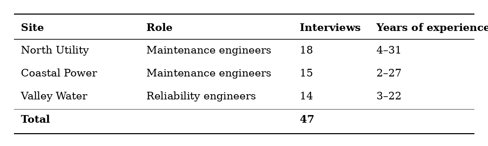
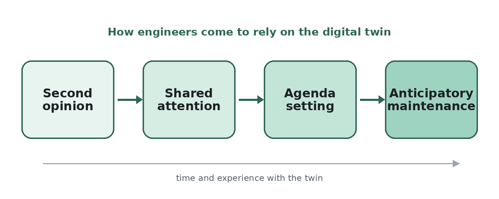

# Research Design

## Data Collection

We conducted {{n_interviews}} between {{fieldwork_period}}.
Table 1 describes the participants.

## Data Analysis

We coded the transcripts in two rounds, first openly and then around the emerging theme of anticipation (Gioia et al., 2013).
The resulting process model is shown in Figure 1.

